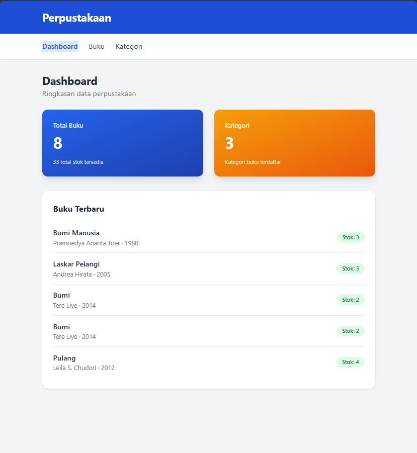
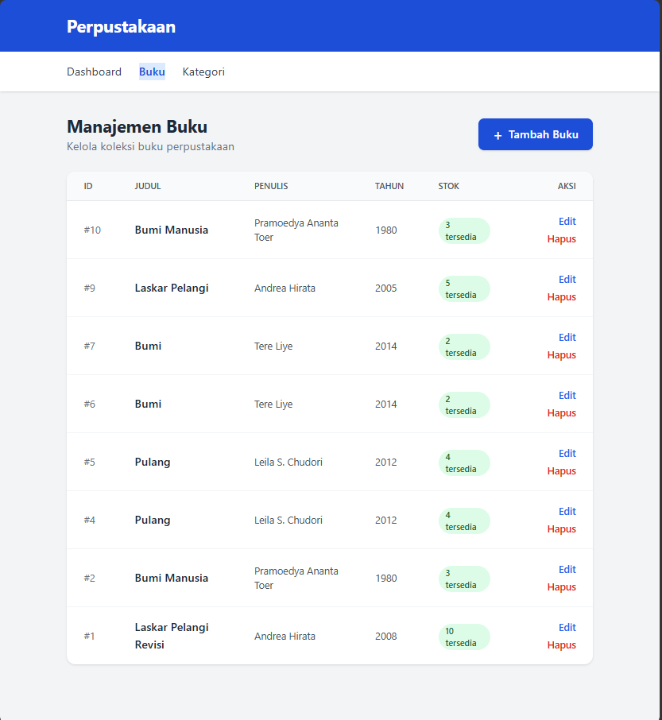
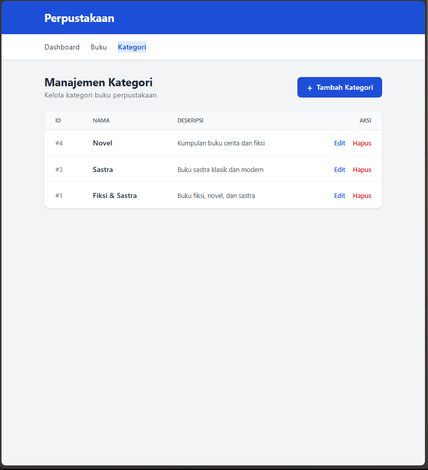

# Sistem Informasi Perpustakaan

Proyek ini dibuat untuk memenuhi Lembar Kerja Mahasiswa (LKS) Praktikum Pemrograman Berbasis Objek.

## Identitas
- **Nama:** Nasywa Akmalia Hanif
- **NIM:** H1101251010
- **Program Studi:** Sistem Informasi
- **Universitas:** Universitas Tanjungpura
- **Kelas:** PBO B

## Fitur
- REST API untuk pengelolaan data buku.
- REST API untuk pengelolaan kategori.
- CRUD buku (Create, Read, Update, Delete).
- CRUD kategori (Create, Read, Update, Delete).
- Dashboard statistik perpustakaan.
- Halaman manajemen buku dan kategori.
- Integrasi frontend dengan backend menggunakan API.
- Notifikasi operasi berhasil dan gagal.

## Teknologi
- PHP 8.4
- MySQL
- JavaScript
- HTML dan CSS
- Tailwind CSS
- Git dan GitHub

## Struktur Proyek
- `rest-api-perpustakaan/` — Backend REST API.
- `frontend-perpustakaan/` — Frontend aplikasi.
- `pertemuan-01/` sampai `pertemuan-07/` — Dokumentasi screenshot setiap langkah.
- `screenshot-final/` — Screenshot hasil akhir aplikasi.

## Cara Menjalankan

### 1. Backend
Masuk ke folder backend:

```bash
cd rest-api-perpustakaan
php -S localhost:8000 -t public
```

### 2. Frontend
Buka terminal baru, lalu jalankan:

```bash
cd frontend-perpustakaan
php -S localhost:3000
```

### 3. Akses Aplikasi
Buka browser:

http://localhost:3000

## Screenshot Final

### Dashboard


### Halaman Buku


### Halaman Kategori


## Dokumentasi Pertemuan
Screenshot pengerjaan tersedia pada folder:
- `pertemuan-01/`
- `pertemuan-02/`
- `pertemuan-03/`
- `pertemuan-04/`
- `pertemuan-05/`
- `pertemuan-06/`
- `pertemuan-07/`

